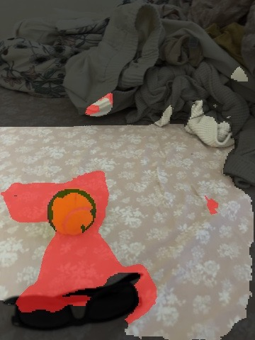
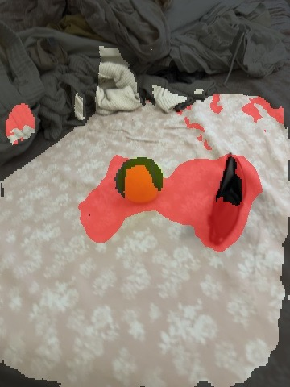
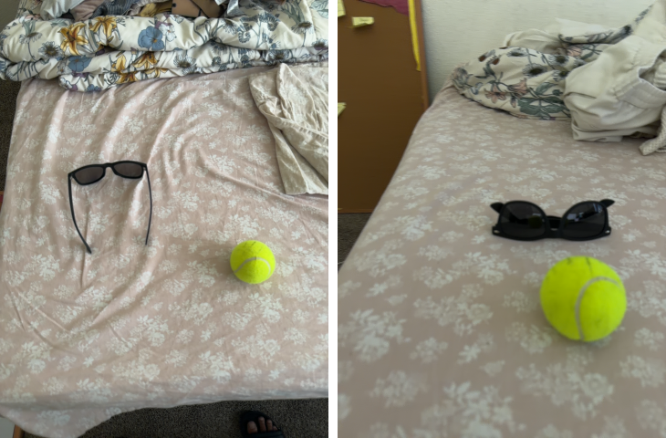
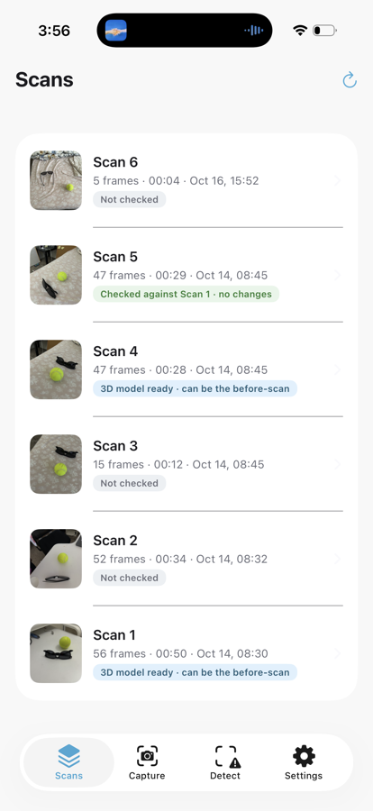
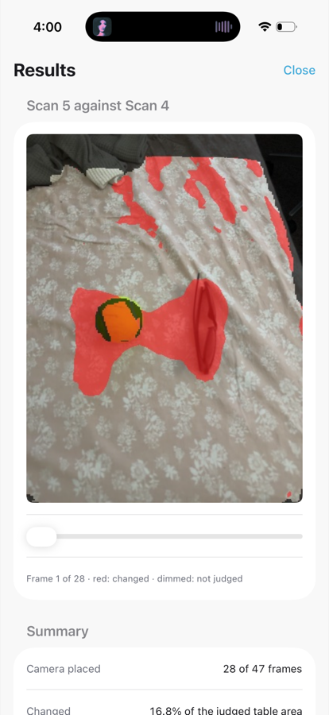

# O-SCD Mobile: demo app runs, 2026-10-16

Device: iPhone 17 Pro (iPhone18,1), iOS 26.6.2 · app "3D Changes" (Release) · Method A (exact O-SCD: XFeat → retrieval → P4P-RANSAC → mini-BA → splatx render → pixel + SAM2.1-tiny cue → online change fusion, 16 steps/frame, no refine) · commits `eed8fddc`, `aa935cbf`, `45c8e054`

## Summary

- **The new demo interface works on the phone.** It has four tabs, Scans / Capture / Detect / Settings. Detect ran Scan 4 → Scan 5 three times with the same result: the camera was placed in **28 of 47 frames**, **16.8 %** of the judged table area changed, **30–35 s** end to end.
- **On the phone, a placed frame costs 0.66–0.67 s (median)** in Detect, with fusion at 264–271 ms. In the live view, which also runs ARKit, fusion costs about 320 ms.
- **Today's scene did not line up with the Oct 14 scans.** The live view placed the camera in 1 of 208 frames against Scan 4, and today's own recording placed it in 1 of 5. The cause is the scene, not the code: the bed sheet that serves as the "table" was re-laid, and a duvet was added.
- **The camera itself worked throughout.** The ARKit log shows the session starting, frames arriving and tracking reaching "normal" within about 1 s on every start. The reported "camera not switching on" was this pose failure.
- **Four other failures were found and fixed:** a build hang from iCloud offloading files, a stale test model being picked as the before-scan, a misleading "no changes" result, and unreadable text in dark mode.

## Scans used

| App label | Folder | Recorded | Frames | Notes |
|---|---|---|---|---|
| Scan 1 | `2026-10-14T15-30-45Z` | Oct 14 08:30 | 56 | white table, mixed portrait/landscape; got a 3D model today (script test, run 2) |
| Scan 4 | `2026-10-14T15-45-15Z` | Oct 14 08:45 | 47 | patterned sheet, portrait; **before-scan**, 3D model trained on the Mac (95,360 Gaussians) |
| Scan 5 | `2026-10-14T15-45-52Z` | Oct 14 08:45 | 47 | same sheet, ball and sunglasses moved; **after-scan** |
| Scan 6 | `2026-10-16T22-52-07Z` | Oct 16 15:52 | 5 | today, same sheet re-laid, duvet added |

## Runs (chronological)

| # | Run | Result | Time |
|---|---|---|---|
| 1 | Detect, Scan 4 → Scan 5 (launch-argument rehearsal) | camera placed 28/47; 16.8 % changed (449,915 of 2,682,903 judged px) | 29.8 s |
| 2 | `tools/build_reference.sh` on Scan 1 (script test) | 56 cameras, 54,211 seed points → 52,368 Gaussians, train-view PSNR 27.5 dB | 58 s |
| 3 | Live view (user), before-scan = Scan 1 | camera placed 0/4 in the last session; "can't place the camera" | – |
| 4 | Detect (user), Scan 1 → Scan 5 | **camera placed 0/47**, nothing judged; the app wrongly said "no changes" | 13.0 s |
| 5 | Detect, Scan 4 → Scan 5 (re-run after fixes) | placed 28/47; 16.8 % changed (449,920 px) | 35.2 s |
| 6 | Detect, Scan 4 → Scan 5 (light-mode build) | placed 28/47; 16.8 % changed (449,914 px) | 31.0 s |
| 7 | Live view (user), before-scan = Scan 4, today's scene | **camera placed 1/208** in 65 s; correspondences median 117 (38–227) | – |
| 8 | Detect, Scan 4 → Scan 6 (today's recording) | **camera placed 1/5** | 5.9 s |

Runs 1, 5 and 6 are the same pair and differ by at most 6 changed pixels between runs.

## Detect timings, Scan 4 → Scan 5 (run 6, median per frame)

| Stage | Median | Frames |
|---|---|---|
| **Setup (once)** | | |
| Load XFeat and SAM2 | 3.76 s | 1 |
| XFeat on the before-scan (47 keyframes) | 0.44 s | 1 |
| Build 3D anchors | 3.18 s | 1 |
| Open the before 3D model (splatx, kernels compiled on the phone) | 0.22 s | 1 |
| Open the change model | 0.22 s | 1 |
| **Per frame** | | |
| XFeat keypoints | 9.5 ms | 47 |
| Find the closest before frames (retrieval) | 115.0 ms | 47 |
| Match keypoints to 3D anchors | 21.8 ms | 47 |
| PnP-RANSAC (2000 hypotheses) | 34.4 ms | 47 |
| Bundle adjustment | 4.4 ms | 47 |
| Render the before model | 15.3 ms | 28 |
| Judged area (LiDAR, table) | 0.5 ms | 28 |
| SAM2 features, render image | 122.3 ms | 28 |
| SAM2 features, live image (runs alongside pose, not on the critical path) | 152.3 ms | 28 |
| Change cue (pixel + SAM2) | 60.8 ms | 28 |
| Fusion (16 steps) | 271.0 ms | 28 |
| Change mask | 7.3 ms | 28 |
| **Total per placed frame** | **674 ms** | 28 |
| **After all frames** | | |
| Final masks (28 frames) | 0.34 s | 1 |

Run 1 gave the same picture: retrieval 108.5, SAM2 render 124.0, fusion 264.1, total 658.4 ms.

Compared with the Oct 14 live preview (≈ 1,209 ms per placed frame, fusion ≈ 676 ms), a Detect frame takes about half as long. Detect doesn't run ARKit or the camera alongside.

 

*Detect, Scan 5 against Scan 4: red = changed, dimmed = not judged. The ball's and sunglasses' old and new positions are flagged; a few small specks remain at the edge of the clothes pile.*

## Live view timings against Scan 4 (run 7, all 208 frames, median)

| Stage | Median |
|---|---|
| XFeat keypoints | 15 ms |
| Find the closest before frames | 169 ms |
| Match keypoints to 3D anchors | 27 ms |
| PnP-RANSAC | 48 ms |
| Bundle adjustment | 5 ms |
| Total per (rejected) frame | 281 ms |
| 2D–3D correspondences | 117 (min 38, max 227) |

**What "placed" means:** O-SCD's gate (`--min_num_inliers 100`) is applied after the final bundle adjustment. It requires more than 100 residual components, i.e. **more than 50 matched points that agree on one camera position**. The number of correspondences is only the pool the agreeing points come from; there is no minimum on it. Today's single placed frame had **52 agreeing points**. On Oct 14, placed frames had 51–352 agreeing points, and some frames with 226–355 correspondences were still rejected. For the single frame placed today, the later stages were: SAM2 render 172 ms, fusion 320 ms, total 844 ms. ARKit reported `insufficientFeatures` near the end of both live sessions.

## Failures and causes

| Failure | Evidence | Cause | Status |
|---|---|---|---|
| **App build hung at "Resolve Package Graph"**, as did a `swift test` run | Xcode and `git status` sat at 0 % CPU; 673 files in `third_party/splatx-metal` and 26,917 in `tools/.venv` had the `dataless` flag; reading one returned nothing within 60 s | iCloud (Desktop sync) offloaded the files and did not download them again | Fixed: splatx re-cloned at `9ae5f66` + our patch in `~/Library/Caches`, symlinked into `third_party/`; the model script uses its own venv there. Old copy kept as `splatx-metal.icloud-offloaded`. README updated |
| **"Camera not switching on" / "can't place the camera"** (runs 3, 4) | ARKit log: session ran, first frame and `tracking normal` within ≈ 1 s on every start; pose rejected on every frame | The before-scan was Scan 1, which only had a 3D model because of the script test (run 2). Scan 1 (white table, mixed orientation) never lined up even on Oct 14 | Fixed: the live view shows and lets you pick the before-scan; Scan 4 set as before-scan |
| **Detect showed "no changes" with 0 frames placed** (run 4) | `summary.json`: framesWithPose 0, judgedPixels 0; scans list chip "Checked against Scan 1 · no changes" | The chip only tested changed pixels | Fixed: now "couldn't line up any frame"; Results say "not judged" |
| **Results text unreadable** | Screenshot: section titles nearly invisible | Phone in dark mode, app colours designed for light | Fixed: app is light-only |
| **Today's scene does not line up with Oct 14 scans** (runs 7, 8) | Live view 1/208 and Detect on today's recording 1/5 against Scan 4, while the same code places 28/47 for Scan 5 against Scan 4; side-by-side images below | The background is a bed sheet: it was re-laid (folds and pattern in new places) and a duvet was added. O-SCD lines up the camera from the static background and assumes it is rigid | Open: needs a rigid base or a fresh before-scan (below) |

*Left: today (Scan 6). Right: Scan 4 (Oct 14). Same objects and sheet pattern, but the sheet has been re-laid with different folds and a duvet added at the head of the bed.*

## Why the old scan cannot be reused here

The re-laid sheet breaks the comparison in two ways:
1. **The camera can't be lined up.** O-SCD places the camera from the static background, and here the background moved. Of a median of 117 matches per frame, fewer than 51 agreed on one camera position in 207 of 208 frames: much of the sheet's pattern now sits at different 3D spots, so many matches point to the wrong place.
2. **Even if it could be lined up, the new folds would be flagged.** They are a real change in shape, so they would be flagged along with the moved objects.

O-SCD's benchmark scenes have rigid backgrounds for this reason.

## Remedies (recommended order)

1. **Rigid patterned base** (poster on card, printed mat) on a desk. A before-scan stays valid, and only moved objects are flagged.
2. **Before-scan on demo day:** record → `tools/build_reference.sh` (≈ 1 min on the Mac) → move objects → record after-scans → Detect.
3. **Rigid room features in the before-scan:** add a few frames from farther back (wall, door, desk), and raise D11's far anchor depth from 1 m to about 3 m, so XFeat + PnP has rigid points to line up against.
4. **ARKit world map as a fallback pose for Method B:** a departure from O-SCD. It helps lining up only; it doesn't stop a re-laid surface from being flagged as change.

## App screens

 

*Left: Scans list (before the chip fix; Scan 5 shows the misleading "no changes"). Right: Results for Scan 5 against Scan 4 after the fixes.*
