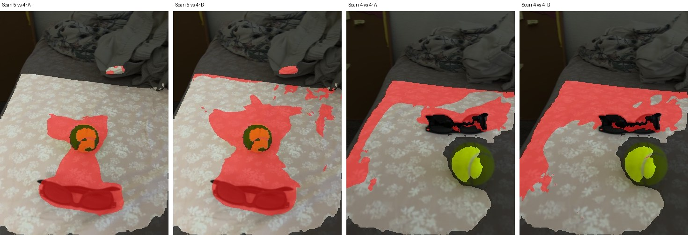
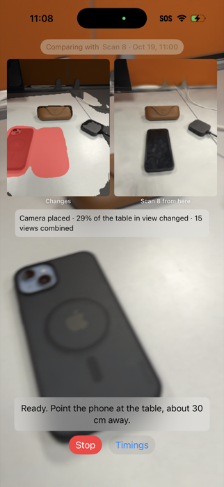

# O-SCD Mobile, phase 2: runs, 2026-10-18 and 2026-10-19

Device: iPhone 17 Pro (iPhone18,1), iOS 26.6.2 · app "3D Changes" (Release) · branch `oscd-mobile/phase1`, commits `6929f032` … `d2f5cb6c` · plan `docs/superpowers/plans/2026-10-18-oscd-mobile-phase2.md`

## Summary

- **The 3D model is now built on the phone.** Scan 4 took **42.2 s** (41.3 s of training, 95,427 Gaussians); the Mac took 47 s for 95,360. Detect with the phone-built model gives the same Method A result as the Mac model: camera placed in 28 of 47 frames, 16.7 % changed (Mac: 16.8 %).
- **Method B runs**, using the same frames and camera positions as A with an A | B toggle.
  - Its first run flagged **84.6 %** of the table: LiDAR reads about 1 cm deeper than the model's rendered depth.
  - Removing the per-frame median depth offset (deviation **D13**) brought it to **37.1 %**.
  - On an unchanged pair (Scan 4 against itself) A flags **11.7 %** and B **17.3 %**.
- **Fusion now runs in parallel** with the next frame's pose and SAM2. A placed frame takes 527 ms end to end with A and B both running, against 674 ms with A alone before.
- **New in the app:**
  - an in-app **3D viewer** (drag to orbit, pinch to zoom), rendering at 32–40 ms per view;
  - a **Build 3D model on this phone** button;
  - a **Live view** that shows which before-scan it compares against.
- **Two app bugs found and fixed:**
  - the Capture screen was black (two AR views);
  - the Live view showed nothing (a callback bound to the wrong parameter).

## On-phone model build

Pipeline:
1. `ColmapExport` writes the scan in COLMAP format: a Swift port of `tools/session_to_colmap.py`.
2. splatx trains on the phone via `sx_train_run_args`: 3,000 iterations, ≤ 200k starting points, SH 3, SSIM weight 0.2, data kept on the GPU, thermal state supplied by the app.
3. The model is written as `reference.ply`; any previous model is kept as `reference.previous.ply`.

| Scan | Frames | LiDAR points | Export | Training | Gaussians | Total |
|---|---|---|---|---|---|---|
| Scan 4 (`2026-10-14T15-45-15Z`) | 47 | 100,003 | 0.5 s | **41.3 s** | 95,427 | 42.2 s |
| Scan 7 (`2026-10-19T17-57-07Z`) | 20 | 76,011 | 0.3 s | 42.2 s | 73,762 | 42.7 s |
| Scan 8 (`2026-10-19T18-00-31Z`) | 35 | 93,055 | 0.4 s | 58.0 s | 89,738 | 58.9 s |
| Mac (M4), Scan 4, same settings | 47 | 100,003 | – | 47 s | 95,360 | – |

**Export parity with the Python script (Scan 4):** cameras identical; 47 poses within 1.8e-7; 100,003 points within 3e-8 m with identical colours; PNGs pixel-identical.

**Against the spec:**
- §11 target "reference training ≤ 90 s": met.
- §1.3 "reference ready ≤ 2 min": met for training; anchors take another 3 s at the start of Detect.

## Detect, Scan 4 → Scan 5, A and B (phone-built model)

| Run | Placed | A changed | B changed | Total |
|---|---|---|---|---|
| A + B, before D13 | 28 / 47 | 16.7 % | **84.6 %** | 28.3 s |
| A + B, with D13 | 28 / 47 | 16.7 % | **37.1 %** | 27 s |
| Scan 4 → Scan 4 (unchanged), with D13 | 47 / 47 | **11.7 %** | 17.3 % | 32 s |

**Per-frame medians, A + B run, ms:**

| Stage | ms |
|---|---|
| XFeat | 12.1 |
| Find the closest before frames | 134.1 |
| Match to 3D anchors | 25.6 |
| PnP-RANSAC | 42.3 |
| Bundle adjustment | 4.2 |
| Render | 11.7 |
| SAM2 (render) | 137.3 |
| SAM2 (live, alongside pose) | 168.9 |
| Change cue | 79.1 |
| **B:** reference depth render | 16.8 |
| **B:** depth + colour cues | 32.4 |
| Wait for the previous frame's fusion | 6.1 |
| **End to end per placed frame** | **527.1** |
| Fusion A (16 steps, on its own thread) | 489.9 |
| Fusion B (16 steps, on its own thread) | 538.3 |

Fusion is slower per method than with A alone (about 270 ms) because the two change models share the GPU, but it no longer holds up the next frame.

*With D13.*
- *Left pair, Scan 5 against Scan 4:* both methods mark the ball's and the sunglasses' old and new positions. B's region around the ball is larger, and it adds specks along the far edge of the sheet.
- *Right pair, Scan 4 against itself (nothing changed):* both methods flag a band along the far and left edges of the sheet, B slightly more. That is O-SCD's own false-alarm baseline on this scene.

### Why the first B run flagged 84.6 % (and D13)

The Mac tool `oscd-fusion-eval depth` compares LiDAR depth, the model's expected depth (Σwz / Σw) and both cues on one frame:

| Frame | Live − render (median) | Depth cue ≥ 0.5, raw | Depth cue ≥ 0.5, offset removed | Colour cue ≥ 0.5 |
|---|---|---|---|---|
| Scan 4, frame 20 (training scan, unchanged) | +0.99 cm | 10.5 % | 3.3 % | 0.0 % |
| Scan 5, frame 20 | +0.61 cm | 8.0 % | 6.9 % | 5.1 % |
| Scan 5, frame 5 | +1.20 cm | 13.9 % | 5.4 % | 4.8 % |

All percentages are of the judged table area.

- **The colour cue is clean.** The depth cue carries a systematic +0.6–1.2 cm bias, so with τ = 1 cm it was small but positive on most of the table, and fusion accumulated it.
- **D13** subtracts each frame's median live − render offset before the tolerance (test `testDepthCueRemovesTheFramesMedianOffset`).
- **The root fix** is spec §7.3's depth-quality step: the median |D_ren − D_lidar| is 1.1 cm, above the 1 cm trigger, so the reference training should get a LiDAR depth term. Not done yet.

## Live view, Scan 8 as before-scan

The headless run uses `-live YES`.

| | |
|---|---|
| Frames placed | **15 / 15**, 0 rejected |
| Update interval | 1.01 s (median) |
| Camera frame → mask | 1.8 s, because fusion is pipelined |

**Per-frame medians, ms:**

| Stage | ms |
|---|---|
| XFeat | 17 |
| Find the closest before frames | 33 |
| Match | 30 |
| PnP-RANSAC | 154 |
| Bundle adjustment | 10 |
| Render | 16 |
| SAM2 (render) | 528 |
| SAM2 (live) | 411 |
| Change cue | 165 |
| Fusion | 820 |
| Change mask | 21 |

SAM2 and fusion are 2–4× slower here than in Detect: the live view also runs ARKit and the camera, and the phone was warm.

*"Scan 8 from here" shows a phone on the table; the Changes panel marks that spot red because the phone has since been removed.*

## 3D viewer

The viewer sits on a scan's detail screen, under **View 3D model**.
- **Camera:** an orbit camera (`OrbitCamera`, OSCDCore, 3 tests) around the table centre, starting from the scan's middle keyframe.
- **Rendering:** splatx renders 540 × 720 on its own thread, always drawing the latest camera.
- **Speed on the phone:** 32–40 ms per view.
- **Checks:** a view turned 70° round and 30° higher (`-viewYawDeg`, `-viewPitchDeg`) renders correctly. Touch gestures were not testable from the Mac.

## Failures and causes

| Failure | Evidence | Cause | Fix |
|---|---|---|---|
| **Capture screen black** (also the Oct 16 "camera not switching on" and the 5-frame Scan 6) | ARKit ran and tracked; first-frame mean luma 107/255 with the phone held at the table, yet the screen was black. Making the Live view's ARView lazy restored the camera. | Two RealityKit ARViews in one app; only one drew the camera feed | One shared ARView for Capture and Live view (`7d160ec4`) |
| **Live view showed nothing** (Scan 8) | Frames reached the worker about once a second; no result was logged or shown | The Live view's trailing closure bound to `fusedB` (Swift 5 backward matching) after Method B added a second callback; the compiler warned `#TrailingClosureMatching` | Callback labelled `fused:` (`d2f5cb6c`); builds are now checked for warnings |
| **Method B flagged 84.6 %** | Depth bias of +0.6–1.2 cm (table above) | LiDAR vs reference expected-depth offset | D13 per-frame offset alignment (`834839ce`) |
| **Builds hung at "Resolve Package Graph"** | 673 offloaded files in splatx, 26,917 in `tools/.venv` | iCloud Desktop offloading | splatx clone and the tools venv moved to `~/Library/Caches` (README) |
| **A flags 11.7 % on an unchanged pair** | Scan 4 → Scan 4 masks | O-SCD false alarms at the sheet's far and left edges (reference quality, edges) | Open: depth-regularised reference training (§7.3), then re-measure |

## Launch arguments for headless checks

| Argument | Effect |
|---|---|
| `-tab capture` | Open Capture |
| `-live YES` | Open the Live view and press Start |
| `-detectBefore <scan> -detectAfter <scan> [-detectB YES] [-detectRefine YES]` | Run Detect |
| `-buildReference <scan>` | Build the 3D model on the phone |
| `-viewModel <scan> [-viewYawDeg d] [-viewPitchDeg d]` | Open the 3D viewer |
| `-beforeScanID <scan>` | Set the before-scan |
