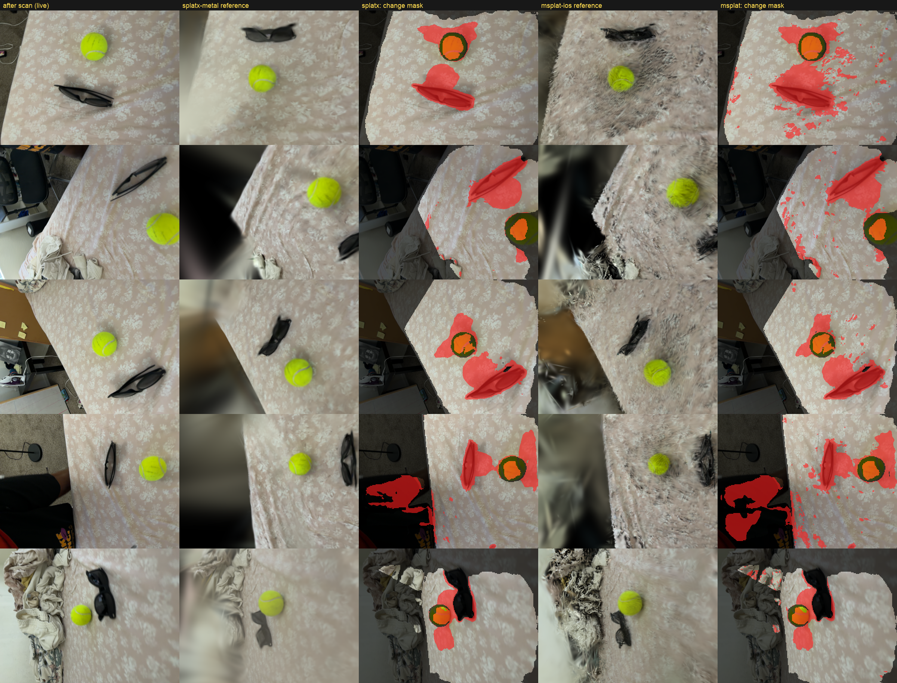

# Spike report: O-SCD Mobile (day 3)

Device: iPhone 17 Pro (iPhone18,1) · app "3D Changes" (Release) · date 2026-10-14 · fixtures scene: pending Sol run (Task 4 Step 3) · sessions: `fixtures/device_pull/sessions/2026-10-14T15-30-45Z` (scan 1, 56 kf) and `…15-32-00Z` (scan 2 after moving objects, 52 kf); white table, tennis ball, sunglasses, phone ≈ 30 cm above the table, no textured mat

Status: **partially filled.** Everything below that can be measured on the development Mac (Apple M4) is
filled in. Every cell that needs the iPhone, Sol, or the splat engines on device says "pending human step".
Fill those in from `Documents/benchmarks/bench_<date>.csv` and Task 17 Steps 3–4, then make the go/no-go.

## On-device timings (median ms, from Documents/benchmarks/bench_<date>.csv)
| Stage | Target (spec §11) | Measured | Pass |
|---|---|---|---|
| XFeat per frame | ≤ 15 | 6.2 (1,020 kpts) | yes |
| Retrieval vs 80 keyframes | ≤ 60 | 21.0 at 1,020 kpts/image (cost grows ~n²: a textured scene near 6,144 kpts would be far slower) | yes, at this keypoint count |
| P4P-RANSAC + mini-BA | ≤ 20 | 36.6 + 7.6 = 44.2 | no |
| SAM2 encoder (pair) | ≤ 240 | 469.8 as one batch of 2; **268.5** as two batch-1 calls (136.3 per image, bench `18-22-37Z`) | no, but only one image is on the critical path in the live preview (below) |
| Pixel cue (SSIM) | n/a | 50.1 | – |
| XFeat on all keyframes + anchor build | ≤ 30 s total | 0.37 s + 1.09 s (52 keyframes) | yes |

Notes for reading the device numbers:
- XFeat ships as an **FP32** Core ML model, so on the iPhone it runs on the GPU rather than the Neural Engine. Every FP16 build tested gave wrong outputs on some compute unit (ledger, Task 5). If `xfeat_detect` misses its target, revisit FP16 with on-device correctness checks.
- SAM2.1-tiny ships as FP16. On the M4 it matches PyTorch to r ≥ 0.9996 on CPU, GPU and Neural Engine alike.

## Anchor yield (D11)
Measured with `oscd-harness anchors` on a **synthetic** tabletop session: 24 ARKit poses on a 0.6 m arc at 0.5 m height, rendered with the real session format. The real-session rows are pending the device capture.

| Depths | Yield (synthetic) | Anchors (synthetic) | Yield (real session) | Decision |
|---|---|---|---|---|
| (1, 10) m, O-SCD | 0.638 | 36,491 | 0.011 (scan 1), 0.027 (scan 2) | rejected: below 0.15 |
| (0.1, 1.0) m | 0.891 | 50,938 | 0.374 (scan 1), 0.313 (scan 2) | **adopted (D11)**: more than 2× higher |

On the CPU parity fixture (4 cameras on a 0.9 m arc), O-SCD's (1, 10) m gate kept 2,841 of 3,000 points (median parallax 174 px against the 45 px gate).

## Real-scan pose test (`oscd-harness pose`, Mac, D11 depths)
| Reference → query | Accepted | Rotation vs ARKit (median) | Position vs ARKit (median) |
|---|---|---|---|
| scan 1 → scan 1 (self) | 56 / 56 | 0.00° | 0.3 mm |
| scan 2 → scan 2 (self) | 52 / 52 | 0.00° | 0.2 mm |
| scan 1 → scan 2 (all frames) | 4 / 52 | 6.63° | 75 mm |
| scan 1 → scan 2 (portrait frames only) | 4 / 24 | 6.63° | 75 mm |

The pipeline is correct on real data (self-tests). Across scans it fails for two reasons, both about the capture, not the code:
1. **Too little static texture.** Anchors sit 51–54% on the objects, 20–25% on the white table and 20–29% off the table. Moving the objects removes most of what PnP localizes against, and the frames that pass lock onto the moved objects (the consistent 6.6° / 75 mm offset).
2. **Phone orientation.** Scan 1 was 50/56 portrait; scan 2 was 24 portrait and 28 landscape. XFeat descriptors are not rotation-invariant, so landscape frames can't match portrait anchors.

Capture rules for the next scans: a patterned mat, newspaper or printed sheet under the objects; the same orientation (portrait) in both scans; the phone about 40–60 cm above the table; slow sweeps.

## Rescan: patterned sheet, portrait only (`fixtures/device_pull2`, scans `15-45-15Z` → `15-45-52Z`, 47 keyframes each)
Floral bed sheet under a tennis ball and sunglasses; objects moved between the scans; phone about 27–36 cm above the surface.

| Check | Result |
|---|---|
| XFeat keypoints per frame | about 3,500 (white table: about 1,000) |
| Anchor yield, D11 depths | 0.576 / 0.577 (white table: 0.31–0.37) |
| Pose before → after | **29 / 47 accepted**, median 0.59° and 8.7 mm from ARKit |
| Pose after → before | **31 / 47 accepted**, median 0.83° and 8.2 mm from ARKit |
| Rejections | all `too_few_inliers` (18 and 16 frames) |
| Pose estimate time (Mac M4, 47 reference keyframes) | median 189–247 ms |

iPhone 17 Pro benchmark (`bench_2026-10-14T15-46-37Z.csv`, 3,485 keypoints per image):

| Stage | ms | Target | Pass |
|---|---|---|---|
| XFeat | 8.8 | ≤ 15 | yes |
| Retrieval vs 80 keyframes | 223.3 | ≤ 60 | **no** (cost grows with the square of the keypoint count) |
| P4P-RANSAC + mini-BA | 38.9 + 8.5 | ≤ 20 | **no** |
| SAM2 pair | 460.8 | ≤ 240 | **no** |
| Pixel cue | 52.1 | – | – |
| XFeat all keyframes + anchor build | 0.47 s + 3.5 s | ≤ 30 s | yes |

Note: the app's `anchor_build` row (yield 0.144) still uses O-SCD's (1, 10) m depths; the D11 yield above comes from the harness.

**Reading:** with static texture and one orientation, O-SCD's XFeat + PnP pose works on the phone's data (sub-degree, under 1 cm against ARKit for accepted frames). The open problem is speed. Retrieval, RANSAC and SAM2 each miss their targets, so a live loop would update masks at roughly 1–2 Hz instead of ≥ 3 Hz. Candidate fixes, in the order spec §11 lists them:
1. D9: fewer keypoints (e.g. 2,048 cuts retrieval by about 3×);
2. retrieval and RANSAC on the GPU (D5);
3. find out why SAM2 isn't faster on the Neural Engine (it may be falling back to the GPU or CPU).

## Splat engines
Reference: the "before" scan `15-45-15Z` exported with `tools/session_to_colmap.py` (47 images at 480×360, 100k LiDAR points). Both engines ran 3,000 iterations on the Mac (M4) with at most 200k Gaussians and a black background. msplat used `--keep-crs` so its model stays in the ARKit world frame. Both models were rendered by the same renderer (`splatx render`) at the "after" scan's 47 ARKit camera poses. Each frame then got O-SCD's per-frame change cue (pixel + SAM2.1-tiny, `generate_candidate_map` semantics, D3 validity: covered by the reference and inside the ROI). The mask is cue > 1.0, **before any multi-view fusion**.

| Check | splatx-metal | msplat-ios |
|---|---|---|
| Mac: 3k iterations | **47.4 s** (16 ms/iter) | **15.9 s** |
| Mac: peak memory | 292 MB | 169 MB |
| PSNR at a training view (same renderer) | **29.4 dB** | 23.7 dB |
| Masked fraction inside the ROI (median over 47 after-frames) | **0.148** | 0.189 |
| Mask quality (see `engine_comparison_masks.png`) | clean: moved ball and sunglasses at old and new positions | same objects plus speckle across the sheet from a noisier reference |
| 3k iterations at 480×360 on the iPhone (s) | **41.3 s** (Scan 4, 95,427 Gaussians; 58.0 s for Scan 8), through the app (2026-10-18) | not measured (fallback not needed) |
| iPhone peak memory (MB) | pending human step | pending human step |
| 1 Custom loss hook (file:line) | added by our patch: `Trainer::backward_custom` (`patches/splatx-oscd-fusion.patch`) | pending source read |
| 2 Per-parameter LR incl. xyz = 0 | yes, via the patch's `torch_adam` (xyz frozen) | pending |
| 3 Expected-depth render | added by our patch: `DepthRenderer` (Σwz / Σw in one render) | pending |
| 4 External densify/prune/reset | yes, via the patch (`OscdFusion.cpp`: clone/split, prune, opacity reset) | pending |
| 5 Rasterizer constants match O-SCD | pending | pending |
| 6 SH degree 0 | trained at SH 3 by default | trained at SH 3 by default |
| 7 Init from our points | yes (COLMAP points3D from LiDAR) | yes (COLMAP points3D from LiDAR) |

Provisional pick: **splatx-metal**. Its reference is clearly better at equal iterations, and that is what the change cue depends on. msplat is 3× faster, so it remains the fallback if splatx-metal misses the ≤ 180 s on-phone budget. Confirm with the iPhone training time and the capability checklist (items 1–5) before Phase 2.

## Live preview on the iPhone (Method A, Preview tab)
Setup: the reference is the splatx model trained on the Mac from the before-scan `15-45-15Z` (`Documents/preview/reference.ply`, 95,360 Gaussians). The before-scan's keyframes are on the phone too (`Documents/preview/before/`). Per frame the phone runs:
XFeat → O-SCD pose (77,525 anchors, D11 depths) → splatx render at that pose → validity (D3) → SAM2 + pixel cue → O-SCD online fusion (`ChangeFusion.addFrame` + 16 steps) → change model rendered at the pose, value > 0.5. Kernels are compiled on the phone from source because iOS 26 rejects Xcode 27's metallib (format 2.9). The log is at `Documents/preview/preview-log.txt`.

| Run | Accepted / total frames | Frame time when tracking (median ms) | Notes |
|---|---|---|---|
| Per-frame cue, no fusion | – | – | masks show up but flicker frame to frame |
| Fusion + Refine button | – | – | refine on the phone takes ≈ 55 s and prunes to a few hundred change Gaussians (521 on the Mac). At viewpoints that were not fused these smear into red streaks, so **Refine was dropped from the live demo** (`1efeb14a`) |
| Online fusion only | 42 / 71 | ≈ 1,450–1,650: fusion 640–1,070, SAM2 420–690, pose 190–330 | changed share steady at 12–14 % of the judged area over the last 18 frames, so the mask no longer flickers |
| + SAM2 batch 1, live image encoded during pose (`e1a332a3`) | 41 / 197 | **1,209** (best 884): fusion 676, SAM2 191 (live 221 alongside pose), pose 285 | rejections came in runs of 50+ frames at views with ≈ 136 correspondences, i.e. the camera was outside the before-scan's coverage |

- SAM2 batch 1 gives the same embeddings as O-SCD's [render, live] batch: r = 1.00000, max |d| = 0.006 against the batch-2 model. FP16 input/output made no difference. Moving the 1024² resize into the model changed the mapping (difference-map r = 0.81), so the resize stays in Swift.
- Fusion is now the largest stage: 16 steps on all 95k reference Gaussians, through splatx's host path (`resident = false`).
- Pose is only reliable near the scanned distance (≈ 25–35 cm) and on the patterned sheet.

## Verified on the Mac (no device or Sol needed)
| Component | Reference it was checked against | Result |
|---|---|---|
| XFeat post-processing + Core ML detector | XFeat's own PyTorch `detectAndCompute` on a real 480×360 photo | both parity tests pass |
| Mini-BA | O-SCD `poses/mini_ba.py` MiniBAInternal on CPU | parity test passes |
| P4P-RANSAC | O-SCD P4P path on CPU (injected samples) | passes; contenders 829/832 within 0.05°, best score identical |
| Triangulation | O-SCD `matches_to_points` on CPU | parity test passes |
| Pixel + feature cues | O-SCD `generate_candidate_map` + `ssim` on CPU with real SAM2.1-tiny | parity test passes |
| SAM2 Core ML | HF SAM2.1-tiny (O-SCD's input path) | r = 0.9999 |
| Full pose pipeline | synthetic 5-view anchors, held-out view | accepted; 0.0°, 0.065 mm error |
| ARKit conventions + session format + COLMAP export | synthetic rendered session | yield 0.638; LiDAR points on the table plane; table centre projects to the principal point at the expected depth |

Still to verify against the real O-SCD on Sol: everything above, at fp16 CUDA on real PASLCD data, plus F-RANSAC (a CUDA-only kernel) and the end-to-end pose and anchor parity.

## Decisions
- Engine: **splatx-metal** (29.4 vs 23.7 dB, cleaner masks; 41–58 s per 3,000-iteration build on the iPhone, inside the ≤ 180 s budget). Capability items 1–4 are covered by our patch; item 5 is still to read.
- Reference build: **on the phone** (Scan detail › Build 3D model on this phone, 42–59 s). `tools/build_reference.sh` remains the Mac path.
- D9 (fewer keypoints or lower resolution): pending device timings.
- D11 (disambiguation depths): **(0.1, 1.0) m adopted**. At 30 cm from the table, keyframes a few cm apart produce too little parallax for O-SCD's 1 m / 10 m gate, so the real-scan yield was 0.011–0.027.
- Live demo: **online O-SCD fusion, no Refine** (Refine stays in `OSCDFusion` for an offline final-result view).
- SAM2: **batch-1 model** (`SAM2_1Tiny_1x1024`), pinned to the Neural Engine. The live image is encoded while the pose is estimated.
- Next speed-ups, biggest first:
  - ~~restrict fusion to the table region~~: dropped. The export already keeps only LiDAR points inside the table box (`tools/session_to_colmap.py:68`), so 98.3 % of the reference's Gaussians (93,701 of 95,360) are inside it already; cropping would save about 2 %.
  - fuse on a background thread and draw each mask from the latest model (exact O-SCD, mask one frame behind);
  - keep the fusion state on the GPU (splatx `resident` mode), after profiling one fusion step;
  - estimate the next frame's pose while the current frame fuses.
- Demo app (Scans / Capture / Detect / Settings): Detect runs Method A over a recorded after-scan against a before-scan with a 3D model. First on-phone run, `15-45-15Z` → `15-45-52Z`:
  - camera placed in 28 of 47 frames; 16.8 % of the judged table area changed;
  - 30 s in total: setup 7.3 s, then 0.66 s per placed frame (median);
  - fusion took 264 ms per frame, against about 680 ms in the live view, which also runs ARKit.
- Phase 2 (2026-10-18/19; details in `2026-10-19_phase2_runs.md`):
  - on-phone model build: 42.2 s for Scan 4, matching the Mac model's Detect result;
  - fusion overlapped with the next frame: 527 ms per placed frame with A and B both running;
  - Method B with D13: Scan 4 → 5, A 16.7 % / B 37.1 %; unchanged Scan 4 → 4, A 11.7 % / B 17.3 %;
  - 3D viewer at 32–40 ms per view.
- Open:
  - depth-regularised reference training: the §7.3 check measured 1.1 cm, above the 1 cm trigger;
  - tune B's λ weights on hand-labelled masks (§8.3);
  - Sol parity fixtures.
- Go / no-go for Phase 2: pending the human steps above.
